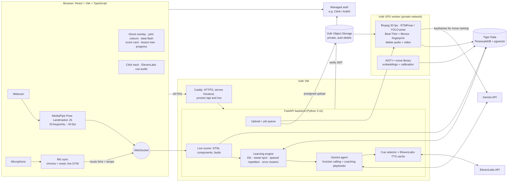

# Shadow

**Learn any dance from any video, with a coach that adapts to every rep.**

Upload a dance video and Shadow turns it into a step-by-step course. You practise in front of your webcam with a ghost dancer to follow, and after every 8-count you get a score, a replay of your weakest moment and one spoken correction. Shadow then picks your next drill based on exactly what you got wrong, and tracks your progress move by move until you've learned the whole routine.

*Just Dance × Duolingo, for the choreography you actually want to learn.*

---

## The problem

- **People learn choreography from videos**, which means endless pausing, rewinding, mirroring and slowing down, with nobody saying what's wrong on *this* attempt.
- **Teachers can't watch every rep** or build a personal plan for every student practising at home.
- **Existing tools don't teach.** Dance games score you on fixed in-game routines. Practice-video players can loop, mirror and slow down, but they give no feedback. Video class apps teach but don't watch you.
- **Too much feedback at once doesn't help.** Motor-learning research favours one cue at a time, focused on the movement's effect, that fades as you improve.

## The solution

Shadow makes **any dance video a personal course** and acts as **a coach that watches every rep**:

1. **Upload** a video of the routine you want to learn.
2. Shadow **models the routine**: beats, 8-counts, key moments and move names.
3. It **builds a lesson tree** that teaches the routine piece by piece, then joins the pieces together.
4. You **practise** with a ghost overlay, live joint colours and a score after every 8-count.
5. A **voice coach** gives you one correction at a time.
6. When you struggle with a move, Shadow **teaches you that move**: it breaks it down into key poses and body parts, then rebuilds it up to full speed.
7. Your **progress is tracked move by move**, and moves come back for review before you forget them.

---

## User stories

**Learner**
- As a dancer learning a routine from a video, I want it broken into 8-counts I can learn one at a time, so that I'm not overwhelmed by the whole thing.
- As a learner, I want to know exactly which count I'm getting wrong and how, so that I can fix it instead of guessing.
- As a learner who keeps failing a move, I want to be taught that move step by step, so that I can learn the choreography I chose, not an easier substitute.
- As a learner, I want to play my own copy of the song and have the app follow along, so that I practise with the real music.
- As a returning learner, I want moves I'm forgetting to come back for review, so that I keep the whole routine in my head.
- As a learner, I want to see my progress on each move, so that I stay motivated and know when I'm ready to perform.

**Coach or choreographer**
- As a dance teacher, I want to upload my routine once and have every student get their own adaptive course, so that they can practise properly between classes.
- As a choreographer, I want my routine's moves named in my own words, so that the cues match how I teach.

**Everyone**
- As a user, I want my videos and the song deleted after processing, so that my data and the artist's music aren't stored.
- As a user, I want the coach to keep me safe: warm-ups, rest when I'm tired, and never "push through the pain".

---

## Features

### 1. Any dance video becomes your course

- **Upload** a front-facing clip, with an agreement that you have the right to use it.
- **Beat analysis:** beats, downbeats and tempo build the counts grid (two bars of 4/4 = one 8-count). A coarse music fingerprint is stored for mic sync (see feature 4). **Then the audio is deleted.**
- **Pose extraction:** the video is converted to 30 fps and the dancer's skeleton is extracted. A **silent** copy is kept, only for the learner's own side-by-side preview; it's private to their account and deleted with the routine.
- **Normalisation:** skeletons are centred on the hips, scaled by torso length (fair for every body size) and mirrored, as dancers usually expect.
- **Routine modelling:** 8-counts, **repeats** (taught once), **key moments** (hits, freezes, turns, level changes) and sections.
- **Move naming** (see feature 5): each segment is named from a labelled move library ("body roll", "toprock"), and you can rename it.
- **Lesson tree** built by the Gemini agent:
  - **Chaining:** learn A → learn B → **A+B** → learn C → **A+B+C**. Each joining step is a checkpoint that tests everything so far.
  - **Speed ladder:** every node has bronze, silver and gold tiers for 0.5×, 0.75× and 1× speed.
  - A difficult or fast routine starts slower.

### 2. A coach that adapts to every rep

- **Count-in:** "5, 6, 7, 8" in the coach's voice, timed to land on the beat.
- **Ghost overlay:** the reference skeleton, scaled to your body and anchored to your hips, drawn over your mirrored webcam feed.
- **Live feedback while you dance:** watched joints turn green, amber or red, a live similarity meter, and a beat flash when your hits land on time. No voice while you're dancing.
- **After each 8-count:**
  - a **score**, split into **shape, timing and dynamics** (sharp hits vs smooth flow);
  - a **replay of your worst count** at 0.5×, your skeleton beside the ghost;
  - **one spoken cue** for the most important fault ("Right arm higher on 6", "Wait for the 5, you're jumping ahead").
- **Cue rules:** one cue per rep, wording about the movement's effect ("punch the wall in front") rather than muscles, and once a fault is fixed for 2 reps the cue drops to "Good, again."
- **Preset coach voices** (ElevenLabs): calm or hype, chosen in settings.

### 3. The adaptive learning engine

| Part | What it does |
|---|---|
| **Mastery model** | An Elo-style rating for you and for each move. It predicts your chance of passing any drill |
| **Sweet-spot drill choice** | The next drill is one you have about a 70–85% chance of passing: hard enough to learn from, not so hard you give up |
| **Spaced repetition** | Every move has a review schedule. Your rep scores act as the "how well did I remember" grade, so reviews schedule themselves |
| **Error clustering** | Your faults across all reps are grouped into habits ("your elbow drops on turns, 7 of the last 10 reps") |
| **Teach the move you're failing** | If you keep failing a move, the coach teaches that same move: **key-pose freezes** at 0.25× (hold each pose until it matches), **body-part isolation** (legs only, then arms only, then together), then back up the speed ladder |
| **Transfer** | Moves you've mastered in one routine count towards another routine that contains them |

**The Gemini agent decides; the tools measure.** Pose, beats, alignment and scoring are deterministic code. The agent, Gemini with function calling and our coaching playbooks, uses their results to plan the course, pick drills and explain its choices ("arms only next: your elbow drops on 3 of your last 4 reps"). You can also type to it: "I have two weeks before the show" or "I keep messing up the turn", and the plan updates.

### 4. Practise to your own copy of the song (mic sync)

- Shadow **never stores or plays the song.** You play it yourself from Spotify, YouTube or a speaker.
- Shadow listens through the microphone and lines up what it hears with the **stored music fingerprint**: coarse harmony (chroma) and rhythm (onset) features, which can't be turned back into the recording.
- **Online alignment** (live dynamic time warping, the technique used for automatic page-turning in live music) tracks **where you are in the song and how fast it's playing**. If you slow the song down in your player, Shadow keeps up.
- A **clap test** measures speaker and microphone delay once, so the timing stays accurate.
- **Fallbacks:** an app-generated click track with count-in at the song's tempo (for 0.5× drills, headphones, or noisy rooms), or tap to sync.

### 5. Scores that mean something: AIST++ calibration and move naming

- **Score calibration:** AIST++ has the same choreography danced by many skilled dancers. The typical difference between two experts sets what "excellent" looks like, and beginners' first attempts set the other end. Scores are mapped between the two, so **"80" means the same thing in every routine**.
- **Move library:** we label a seed library of common moves from AIST++ clips. Each new 8-count's segments are matched by nearest neighbour (DTW distance and pgvector search) to name them.
- For segments with no close match, Gemini suggests a name from 3–4 keyframes (from the silent preview copy) plus pose hints and the style's vocabulary, with a confidence shown. Your renames are saved to your glossary and reused.

### 6. Progress metrics

| Metric | What it shows |
|---|---|
| **Move mastery** | Mastery rating per move, and the speed tier reached (bronze, silver, gold) |
| **Reps to learn** | How many reps each 8-count took to pass. It should fall as you improve |
| **Time to learn** | Practice time until each section passed at full speed |
| **Score trends** | Shape, timing and dynamics over days |
| **Timing habits** | Early or late tendency, and how consistent you are, by section |
| **Error habits** | Your top recurring faults, and whether they're fading |
| **Retention** | Score on review vs your last score, i.e. how well moves stick |
| **Routine readiness** | % of the routine passed at full speed, and the weakest counts with replays (tap to practise) |
| **Consistency and stamina** | Variation across full runs, and first-half vs second-half scores |
| **Streaks and XP** | Daily streak, XP, unlocks and checkpoint badges |

---

## Architecture

**Why it's split this way**
- **Live pose runs in the browser.** That gives the lowest latency, and only keypoints leave the device, never video.
- **Heavy processing runs on the GPU worker:** pose on uploads, beat analysis, fingerprints and the move library. It has no public address and is reached only over Vultr's private network.
- **The agent works between reps, never during them.** The live loop is deterministic code plus cached cue audio, so it stays fast.

### Tech stack

| Layer | Choice |
|---|---|
| Frontend | React + Vite + TypeScript, Canvas 2D overlays |
| Live pose | MediaPipe Pose Landmarker (Tasks JS), 33 landmarks |
| Mic sync | Web Audio API (AudioWorklet): chroma + onset features, online DTW |
| Backend | Python 3.11, FastAPI, Uvicorn, WebSockets |
| Upload pose | `rtmlib` (RTMPose) or Ultralytics YOLO-pose |
| Audio analysis | Beat This! (beats + downbeats), librosa (onsets, chroma, sections) |
| Alignment | NumPy DTW with a Sakoe-Chiba band (or `tslearn`) |
| Video | ffmpeg (30 fps transcode, frame extraction) |
| Agent | Gemini API: function calling, structured JSON output (response schemas), image input for move naming. Model names configurable (a fast model for cues and naming, a stronger one for planning) |
| Voice | ElevenLabs TTS (preset voices, cached cues and count-ins) |
| Database | Tiger Data: TimescaleDB hypertables + continuous aggregates, pgvector |
| Hosting | Vultr VM (Docker Compose + Caddy), Vultr GPU worker, Vultr Object Storage |
| Login | Managed auth provider (e.g. Clerk or Auth0) |

### The Gemini agent

**Tools** (deterministic code it can call): `segment_routine`, `score_rep`, `get_mastery`, `get_error_clusters`, `schedule_review`, `make_drill(segment, speed, mirror, body_parts, freeze_poses)`, `get_history`.

**Coaching playbooks** (markdown files of coaching knowledge; the backend loads the relevant ones into the agent's instructions for each task):

| Playbook | Contents |
|---|---|
| `curriculum-design` | Lesson tree rules, chaining, speed ladder, unlock thresholds |
| `dance-cues` | Cue library by fault type, one cue at a time, external focus, fading |
| `coach-persona` | Tone and phrasing for each preset voice |
| `practice-review` | Reads mastery, spaced-repetition state and error habits to choose the next drill; writes the session summary |
| `dance-safety` | Detailed safety policy |

All tool inputs and outputs are schema-checked. The hard rules (safety, data access, step and cost limits) are enforced in code and the system prompt, not only in a playbook. Gemini returns only schema-validated JSON, never free text into the UI.

### Data model (Tiger Data)

- **Hypertables:** `rep_scores` (every rep: score, components, per-count scores, top fault, speed), `pose_frames` (keypoints with music time, compressed after 1 day), `sessions`.
- **Tables:** `routines` (8-counts, key moments, fingerprint, lesson plan), `moves` (embeddings in pgvector, names, AIST++ labels), `mastery` (Elo per user per move), `reviews` (spaced-repetition schedule), `error_clusters`.
- **Continuous aggregates:** daily progress per routine and per move, reps-to-learn, timing habits. These power the progress page.

---

## Responsible by design

**Copyright**
- The uploaded **audio is deleted** after the beats and fingerprint are extracted. The fingerprint can't recreate the recording.
- The **song is never stored or played** by Shadow. You play your own copy, or practise to the click track.
- **Only a silent copy of the video is kept**, private to the learner, for the side-by-side preview; deleting the routine deletes it. Replays of the learner show skeletons, never their webcam footage.
- Uploads need a rights agreement (your own routine, your teacher's, or personal practice), and there's no feature for re-sharing someone else's choreography.

**Privacy and security**
- The live loop sends only keypoints, never video.
- Login is required; each user can reach only their own data. You can delete your data in one tap.
- The server publishes HTTPS only. The GPU worker, storage and database are private.
- API keys never reach the browser.

**Safety**
- Warm-up prompt, a cap on reps per session, and "stop if it hurts".
- Flips, drops and lifts are flagged: shown, not drilled.
- When scores drop from fatigue, the coach suggests a rest or ending the session.
- Cues are short, chosen from a vetted library, and contain no medical advice.

**Fairness**
- Scores are normalised for body size and shape.
- A seated or reduced-range option changes which joints are watched.

---

## Sponsor tracks

| Track | How Shadow uses it |
|---|---|
| **Gemini API** | The agent: plans the course, picks drills, explains its choices, re-plans from typed requests, and names moves from keyframes |
| **ElevenLabs** | The coach's voice: count-ins timed to the beat, one cue per rep, cached for instant playback |
| **Tiger Data** | One database for rep time series, continuous aggregates for progress, and pgvector for the move library |
| **Vultr** | The whole deployment: web VM, GPU ingest worker on a private network, object storage |

---

## What's next

- **Presage vitals** in an Electron desktop version (Presage's SDKs are on-device, with a Node/Electron SDK): pre-run heart-rate check and a recovery gate between reps
- **Group mode:** a sync heatmap of who's early or late on each count, formation and spacing tracking, and remote sync for teams recording at home
- **Voice options:** a "Why?" voice conversation with the coach, hands-free commands ("again", "slower"), and the coach's own voice with consent
- **3D pose** for turns and floor work
